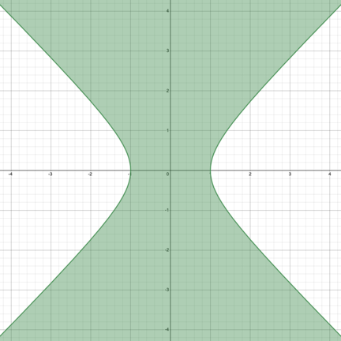

# Smtlink 3


*Smtlink 3* is a framework for translating ACL2 proof goals to SMT-LIB for external proof. It uses the ACL2 rewriter for verified type inference and term rewriting.

It extends Peng and Greenstreet's [Smtlink 2.0](https://doi.org/10.4204/eptcs.280.11).

## Requirements

* ACL2

Smtlink targets ACL2 8.7 and above. Setting your `ACL2_HOME` environment variable to the ACL2 source directory allows the build tools to find them.

* Z3

The default Smtlink configuration defaults to using whichever z3 binary exists in your path. If you have z3 in a location outside your path, copy `smtlink3-config` to your home directory and modify `smt-cmd` to point to the location of your z3 executable.

## Build Smtlink

This separate repository tracks the Smtlink 3 project.
If `ACL2_HOME` is not set in your environment, you can provide it at build time:
```
make ACL2_HOME=<PATH_TO_YOUR_ACL2_SOURCES> top
```

### The Makefile has two targets:
- The *top* target builds the Smtlink 3 books. This is the default.
- The *example* target runs the proofs from the paper.

## Loading Smtlink

To import the required books, initialize the needed computed hints, and start the tshell subsystem, execute the following lines in your ACL2 REPL:

```
(include-book "hints/hint-wrapper" :dir :system)
(add-default-hints '((hint-wrapper-hint clause)))
(include-book "<PATH_TO_SMTLINK3_SOURCES>/top")
(add-default-hints '((SMT::SMT-computed-hint clause stable-under-simplificationp)))
(value-triple (tshell-ensure))
```
## Examples

### Example 1

This is a nonlinear inequality example originally from the [Smtlink 2.0 paper](https://doi.org/10.4204/eptcs.280.11).

#### Background

Say you have a system of nonlinear inequalities. Given these two inequalities:

```(<= (+ (* (/ 9 8) x x) (* y y)) 1)```


```(<= (x^2-y^2 x y) 1)```


Can we presume the following?

```
(< y
   (- (* 3
         (- x (/ 17 8))
         (- x (/ 17 8)))
      3))
```


ACL2 is unable to prove the theorem directly, even with the nonlinear support in `arithmetic-5`:

```
(defun x^2-y^2 (x y)
  (- (* x x)
     (* y y)))

(implies (and (real/rationalp x)
              (real/rationalp y)
              (<= (+ (* (/ 9 8)
                        x
                        x)
                     (* y y))
                  1)
              (<= (x^2-y^2 x y)
                  1))
         (< y
            (- (* 3
                  (- x (/ 17 8))
                  (- x (/ 17 8)))
               3)))
...
:(
```

Smtlink 3 can use an external SMT solver (Z3 in this case) to prove the theorem, given a translation theory that specializes the polymorphic arithmetic operators to real/rational ones:

```
(defun x^2-y^2 (x y)
  (- (* x x)
     (* y y)))

(defthm poly-ineq-example
  (implies (and (real/rationalp x)
                (real/rationalp y)
                (<= (+ (* (/ 9 8)
                          x
                          x)
                       (* y y))
                    1)
                (<= (x^2-y^2 x y)
                    1))
           (< y
              (- (* 3
                    (- x (/ 17 8))
                    (- x (/ 17 8)))
                 3)))
  :hints (("Goal" :smtlink
                    (:translation-theory
                     (union-theories
                       (theory 'minimal-theory)
                       '(smt::return-of-rational-+
                         smt::return-of-rational--
                         smt::return-of-rational-*
                         smt::return-of-rational-/
                         smt::return-of-rational-<
                         smt::specialize-binary-rational-operators
                         smt::specialize-unary-rational-
                         smt::specialize-unary-rational-/))))))
...
Subgoal 2.6.2.2'
writing
((|declare-sort| ANY-P$INLINE 0)
 (|declare-fun| RATIONALP (ANY-P$INLINE)
                |Bool|)
 (|declare-const| X |Real|)
 (|declare-const| Y |Real|)
 (|assert| (|not| (|ite| (< 1 (+ (* Y Y) (* (/ 9 8) (* X X))))
                         |true|
                         (|ite| (< 1 (+ (* X X) (- (* Y Y))))
                                |true|
                                (< Y
                                   (+ (/ 675 64)
                                      (+ (* 3 (* (/ (- 17) 8) X))
                                         (+ (* 3 (* (/ (- 17) 8) X))
                                            (* 3 (* X X))))))))))
 (|check-sat|))
...
Q.E.D.

Summary
Form:  ( DEFTHM POLY-INEQ-EXAMPLE ...)
Rules: ((:COMPOUND-RECOGNIZER BOOLEANP-COMPOUND-RECOGNIZER)
        (:DEFINITION ANY-P$INLINE)
        (:DEFINITION HINT-WRAPPER)
        (:DEFINITION NOT)
        (:DEFINITION SYNP)
        (:DEFINITION X^2-Y^2)
        (:EXECUTABLE-COUNTERPART ANY-P$INLINE)
        (:EXECUTABLE-COUNTERPART BINARY-*)
        (:EXECUTABLE-COUNTERPART BINARY-+)
        (:EXECUTABLE-COUNTERPART BOOLEANP)
        (:EXECUTABLE-COUNTERPART IF)
        (:EXECUTABLE-COUNTERPART INTEGERP)
        (:EXECUTABLE-COUNTERPART NOT)
        (:EXECUTABLE-COUNTERPART RATIONALP)
        (:EXECUTABLE-COUNTERPART SYMBOLP)
        (:FAKE-RUNE-FOR-TYPE-SET NIL)
        (:REWRITE ASSOCIATIVITY-OF-+)
        (:REWRITE COMMUTATIVITY-2-OF-+)
        (:REWRITE COMMUTATIVITY-OF-*)
        (:REWRITE COMMUTATIVITY-OF-+)
        (:REWRITE DISTRIBUTIVITY)
        (:REWRITE FOLD-CONSTS-IN-+)
        (:REWRITE SMT::RETURN-OF-RATIONAL-*)
        (:REWRITE SMT::RETURN-OF-RATIONAL-+)
        (:REWRITE SMT::RETURN-OF-RATIONAL--)
        (:REWRITE SMT::RETURN-OF-RATIONAL-<)
        (:REWRITE SMT::RETURN-OF-RATIONALP)
        (:REWRITE SMT::SPECIALIZE-BINARY-RATIONAL-OPERATORS)
        (:REWRITE SMT::SPECIALIZE-UNARY-RATIONAL-)
        (:TYPE-PRESCRIPTION NONNEGATIVE-PRODUCT))
Hint-events: ((:CLAUSE-PROCESSOR SMT::PROCESS-HINT-CP)
              (:CLAUSE-PROCESSOR SMT::REMOVE-HINT-PLEASE)
              (:CLAUSE-PROCESSOR SMT::SMTLIB-TRUSTED-CP)
              (:CLAUSE-PROCESSOR SMT::TERM-REWRITE-CP)
              (:CLAUSE-PROCESSOR SMT::TTERM-TYPE-EXTRACT-CP)
              (:CLAUSE-PROCESSOR SMT::TYPE-JUDGE-BOTTOM-UP-CP)
              (:CLAUSE-PROCESSOR SMT::TYPE-JUDGE-TOP-DOWN-CP))
Time:  0.09 seconds (prove: 0.09, print: 0.00, other: 0.00)
Prover steps counted:  8395
 POLY-INEQ-EXAMPLE
```