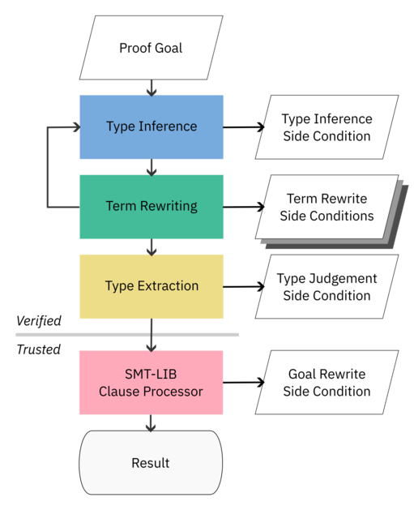

# Smtlink 3



*Smtlink 3* is a framework for translating ACL2 proof goals to SMT-LIB for external proof. It uses the ACL2 rewriter for verified type inference and term rewriting.

Presented at the [ACL2 2026 Workshop](https://www.cs.utexas.edu/~moore/acl2/workshop-2026/index.html).
Smtlink 3 extends Peng and Greenstreet's [Smtlink 2.0](https://doi.org/10.4204/eptcs.280.11) with type inference and rewrite-driven compilation to [SMT-LIB](https://smt-lib.org/).

## Requirements

* ACL2

Smtlink targets ACL2 8.7 and above. Setting your `ACL2_HOME` environment variable to the ACL2 source directory allows the build tools to find them.

* Z3

The default Smtlink configuration defaults to using whichever z3 binary exists in your path. If you have z3 in a location outside your path, copy `smtlink3-config` to your home directory and modify `smt-cmd` to point to the location of your z3 executable.

## Build Smtlink

This separate repository tracks the Smtlink 3 project.
If `ACL2_HOME` is not set in your environment, you can provide it at build time:
```
make ACL2_HOME=<PATH_TO_YOUR_ACL2_SOURCES> top
```

### The Makefile has two targets:
- The *top* target builds the Smtlink 3 books. This is the default.
- The *example* target runs the proofs from the paper.

## Loading Smtlink

To import the required books, initialize the needed computed hints, and start the tshell subsystem, execute the following lines in your ACL2 REPL:

```
(include-book "hints/hint-wrapper" :dir :system)
(add-default-hints '((hint-wrapper-hint clause)))
(include-book "<PATH_TO_SMTLINK3_SOURCES>/top")
(add-default-hints '((SMT::SMT-computed-hint clause stable-under-simplificationp)))
(value-triple (tshell-ensure))
```
## Examples

### Nonlinear real arithmetic

This is a nonlinear inequality example originally from Peng and Greenstreet's [Smtlink 2.0 paper](https://doi.org/10.4204/eptcs.280.11).

#### Background

Say you have a system of nonlinear inequalities. Given these two inequalities:


```
(<= (+ (* (/ 9 8)
          x
	  x)
       (* y y))
     1)
```


```
(<= (x^2-y^2 x y)
    1)
```

Can we presume the following?


```
(< y
   (- (* 3
         (- x (/ 17 8))
         (- x (/ 17 8)))
      3))
```

ACL2 is unable to prove the theorem directly, even with the nonlinear support in `arithmetic-5`:

```
(defun x^2-y^2 (x y)
  (- (* x x)
     (* y y)))

(implies (and (real/rationalp x)
              (real/rationalp y)
              (<= (+ (* (/ 9 8)
                        x
                        x)
                     (* y y))
                  1)
              (<= (x^2-y^2 x y)
                  1))
         (< y
            (- (* 3
                  (- x (/ 17 8))
                  (- x (/ 17 8)))
               3)))
...
:(
```

Smtlink 3 can use an external SMT solver (Z3 in this case) to prove the theorem, given a translation theory that specializes the polymorphic arithmetic operators to real/rational ones:

```
(defun x^2-y^2 (x y)
  (- (* x x)
     (* y y)))

(defthm poly-ineq-example
  (implies (and (real/rationalp x)
                (real/rationalp y)
                (<= (+ (* (/ 9 8)
                          x
                          x)
                       (* y y))
                    1)
                (<= (x^2-y^2 x y)
                    1))
           (< y
              (- (* 3
                    (- x (/ 17 8))
                    (- x (/ 17 8)))
                 3)))
  :hints (("Goal" :smtlink
                    (:translation-theory
                     (union-theories
                       (theory 'minimal-theory)
                       '(smt::return-of-rational-+
                         smt::return-of-rational--
                         smt::return-of-rational-*
                         smt::return-of-rational-/
                         smt::return-of-rational-<
                         smt::specialize-binary-rational-operators
                         smt::specialize-unary-rational-
                         smt::specialize-unary-rational-/))))))
...
Subgoal 2.6.2.2'
writing
((|declare-sort| ANY-P$INLINE 0)
 (|declare-fun| RATIONALP (ANY-P$INLINE)
                |Bool|)
 (|declare-const| X |Real|)
 (|declare-const| Y |Real|)
 (|assert| (|not| (|ite| (< 1 (+ (* Y Y) (* (/ 9 8) (* X X))))
                         |true|
                         (|ite| (< 1 (+ (* X X) (- (* Y Y))))
                                |true|
                                (< Y
                                   (+ (/ 675 64)
                                      (+ (* 3 (* (/ (- 17) 8) X))
                                         (+ (* 3 (* (/ (- 17) 8) X))
                                            (* 3 (* X X))))))))))
 (|check-sat|))
...
Q.E.D.

Summary
Form:  ( DEFTHM POLY-INEQ-EXAMPLE ...)
Rules: ((:COMPOUND-RECOGNIZER BOOLEANP-COMPOUND-RECOGNIZER)
        (:DEFINITION ANY-P$INLINE)
        (:DEFINITION HINT-WRAPPER)
        (:DEFINITION NOT)
        (:DEFINITION SYNP)
        (:DEFINITION X^2-Y^2)
        (:EXECUTABLE-COUNTERPART ANY-P$INLINE)
        (:EXECUTABLE-COUNTERPART BINARY-*)
        (:EXECUTABLE-COUNTERPART BINARY-+)
        (:EXECUTABLE-COUNTERPART BOOLEANP)
        (:EXECUTABLE-COUNTERPART IF)
        (:EXECUTABLE-COUNTERPART INTEGERP)
        (:EXECUTABLE-COUNTERPART NOT)
        (:EXECUTABLE-COUNTERPART RATIONALP)
        (:EXECUTABLE-COUNTERPART SYMBOLP)
        (:FAKE-RUNE-FOR-TYPE-SET NIL)
        (:REWRITE ASSOCIATIVITY-OF-+)
        (:REWRITE COMMUTATIVITY-2-OF-+)
        (:REWRITE COMMUTATIVITY-OF-*)
        (:REWRITE COMMUTATIVITY-OF-+)
        (:REWRITE DISTRIBUTIVITY)
        (:REWRITE FOLD-CONSTS-IN-+)
        (:REWRITE SMT::RETURN-OF-RATIONAL-*)
        (:REWRITE SMT::RETURN-OF-RATIONAL-+)
        (:REWRITE SMT::RETURN-OF-RATIONAL--)
        (:REWRITE SMT::RETURN-OF-RATIONAL-<)
        (:REWRITE SMT::RETURN-OF-RATIONALP)
        (:REWRITE SMT::SPECIALIZE-BINARY-RATIONAL-OPERATORS)
        (:REWRITE SMT::SPECIALIZE-UNARY-RATIONAL-)
        (:TYPE-PRESCRIPTION NONNEGATIVE-PRODUCT))
Hint-events: ((:CLAUSE-PROCESSOR SMT::PROCESS-HINT-CP)
              (:CLAUSE-PROCESSOR SMT::REMOVE-HINT-PLEASE)
              (:CLAUSE-PROCESSOR SMT::SMTLIB-TRUSTED-CP)
              (:CLAUSE-PROCESSOR SMT::TERM-REWRITE-CP)
              (:CLAUSE-PROCESSOR SMT::TTERM-TYPE-EXTRACT-CP)
              (:CLAUSE-PROCESSOR SMT::TYPE-JUDGE-BOTTOM-UP-CP)
              (:CLAUSE-PROCESSOR SMT::TYPE-JUDGE-TOP-DOWN-CP))
Time:  0.09 seconds (prove: 0.09, print: 0.00, other: 0.00)
Prover steps counted:  8395
 POLY-INEQ-EXAMPLE
```

### Using existing ACL2 theorems in SMT proofs

This is a real exponentiation example originally from Peng and Greenstreet's [Integrating SMT with Theorem Proving for Analog/Mixed-Signal Circuit Verification](https://doi.org/10.1007/978-3-319-17524-9_22) paper.
SMT theory support can be limited, due to the semi-decidable nature of the underlying solvers, etc.
For instance, the SMT-LIB real number theory doesn't support exponentiation, so calls to ACL2 `expt` are treated as uninterpreted functions, which greatly reduces the ability of the solver to reason about theorems such as this:

```
(defthm poly-of-expt-example
  (implies (and (real/rationalp x)
                (real/rationalp y)
                (real/rationalp z)
                (integerp m)
                (integerp n)
                (< 0 z)
                (< z 1)
                (< 0 m)
                (< m n))
	   (<= (* 2 (expt z n) x y)
	       (* (expt z m) (x^2+y^2 x y)))))
```

One way to help the SMT solver is to define a theory of rational exponentiation, prove some laws about those functions, and give those rules to the solver as hypotheses it can use to reason about otherwise uninterpreted functions.

Start with an encapsulation to define a clique of constrained functions for rational exponentiation, and declare their existence via the Smtlink hint table:

```
(encapsulate
    (((rational-expt * *) => *)
     ((int-to-rat *) => *))

  (local (include-book "arithmetic-5/top" :dir :system))

  (local
    (defun rational-expt (x y)
      (expt (rfix x) (ifix y))))

  (local
    (defun int-to-rat (x)
      (rfix x)))

  (defthmd expt-inequality-lemmas
    (implies (and (real/rationalp z)
                  (integerp m)
                  (integerp n)
                  (< 0 z)
                  (< z 1)
                  (< 0 m)
                  (< m n))
             (and (< (expt z n) (expt z m))
                  (< 0 (expt z m))
                  (< 0 (expt z n)))))

  (defthm return-of-expt
    (implies (and (rationalp x)
                  (integerp y))
             (rationalp (expt x y))))

  (defthm return-of-rational-expt
    (implies (and (rationalp x)
                  (integerp y))
             (rationalp (rational-expt x y))))

  (defthm return-of-int-to-rat
    (implies (integerp x)
             (rationalp (int-to-rat x))))

  (defthmd generalize-binary-rational-operators-left
    (implies (and (integerp x)
		  (rationalp y))
	     (and (equal (binary-+ x y)
			 (binary-+ (int-to-rat x) y))
		  (equal (binary-* x y)
			 (binary-* (int-to-rat x) y))
		  (equal (< x y)
			 (< (int-to-rat x) y)))))

  (defthmd generalize-binary-rational-operators-right
    (implies (and (rationalp x)
		  (integerp y))
	     (and (equal (binary-+ x y)
			 (binary-+ x (int-to-rat y)))
		  (equal (binary-* x y)
			 (binary-* x (int-to-rat y)))
		  (equal (< x y)
			 (< x (int-to-rat y))))))

  (defthmd generalize-unary-integer--
    (implies (integerp x)
	     (equal (unary-- x)
		    (unary-- (int-to-rat x)))))

  (defthmd generalize-unary-integer-/
    (implies (and (integerp x)
		  (not (= x 0)))
	     (equal (unary-/ x)
		    (unary-/ (int-to-rat x)))))

  (defthmd specialize-rational-expt
    (implies (and (rationalp x)
		  (integerp y))
	     (equal (expt x y)
		    (rational-expt x y))))

(smt::add-smtlink-hint
  :expt
  (smt::make-smtlink-hint
    :acl2types (smt::make-acl2types)
    :datatypes (smt::make-datatypes)
    :functions (append
                 (list
                   (smt::make-smt-function :name 'expt
                                      :kind :basic
                                      :returns (list (smt::make-thm-spec
                                                       :formals '(x y)
                                                       :thm
                                                       'return-of-expt)))
                   (smt::make-smt-function :name 'rational-expt
                                      :kind :basic
                                      :returns (list (smt::make-thm-spec
                                                       :formals '(x y)
                                                       :thm
                                                       'return-of-rational-expt)))
		   (smt::make-smt-function :name 'int-to-rat
				      :kind :basic
				      :returns (list (smt::make-thm-spec
						       :formals '(x)
					               :thm
						       'return-of-int-to-rat))))
                 (smt::make-basic-functions))
    :replaces (smt::make-basic-replaces)
    :configurations (smt::make-smt-config :smt-cnf (smt::default-smt-cnf)))))

```

Then we can provide a `:use` hint to add the hypothesis to the goal before translating it to a SMT-LIB query:

```
;; This theorem seems to trigger an issue inside the waterfall
;; SHORT-TERM TODO
(assign slow-array-action nil)

(defun x^2+y^2 (x y)
  (+ (* x x) (* y y)))

(defthm poly-of-expt-example
  (implies (and (real/rationalp x)
                (real/rationalp y)
                (real/rationalp z)
                (integerp m)
                (integerp n)
                (< 0 z)
                (< z 1)
                (< 0 m)
                (< m n))
	   (<= (* 2 (expt z n) x y)
	       (* (expt z m) (x^2+y^2 x y))))
  :hints (("Goal"
            :in-theory (disable expt-inequality-lemmas)
            :use ((:instance expt-inequality-lemmas)))
          ("Goal'"
	    :smtlink-custom
	    (:global-hint
	     :expt
	     :translation-theory
             (union-theories
	       (theory 'minimal-theory)
	       '(smt::return-of-rational-+
                 smt::return-of-rational--
                 smt::return-of-rational-*
                 smt::return-of-rational-/
                 smt::return-of-rational-<
                 return-of-int-to-rat
                 return-of-rational-expt
                 specialize-rational-expt
		 generalize-binary-rational-operators-left
		 generalize-binary-rational-operators-right
		 generalize-unary-integer--
		 generalize-unary-integer-/
                 smt::specialize-binary-rational-operators
                 smt::specialize-unary-rational-
                 smt::specialize-unary-rational-/))))))
...
Subgoal 2.14.2.2'
writing
((|declare-sort| ANY-P$INLINE 0)
 (|declare-fun| INTEGERP (ANY-P$INLINE)
                |Bool|)
 (|declare-fun| RATIONAL-EXPT (|Real| |Int|)
                |Real|)
 (|declare-fun| RATIONALP (ANY-P$INLINE)
                |Bool|)
 (|declare-const| M |Int|)
 (|declare-const| N |Int|)
 (|declare-const| X |Real|)
 (|declare-const| Y |Real|)
 (|declare-const| Z |Real|)
 (|assert|
  (|not|
   (|ite|
    (|not| (< (RATIONAL-EXPT Z N)
              (RATIONAL-EXPT Z M)))
    |true|
    (|ite|
     (|not| (< (|to_real| 0) (RATIONAL-EXPT Z M)))
     |true|
     (|ite|
      (|not| (< (|to_real| 0) (RATIONAL-EXPT Z N)))
      |true|
      (|ite|
       (|not| (< (|to_real| 0) Z))
       |true|
       (|ite|
         (|not| (< Z (|to_real| 1)))
         |true|
         (|ite|
              (|not| (< (|to_real| 0) (|to_real| M)))
              |true|
              (|ite| (|not| (< (|to_real| M) (|to_real| N)))
                     |true|
                     (|not| (< (+ (* X (* X (RATIONAL-EXPT Z M)))
                                  (* Y (* Y (RATIONAL-EXPT Z M))))
                               (* (|to_real| 2)
                                  (* X (* Y (RATIONAL-EXPT Z N)))))))))))))))
 (|check-sat|))
...
Q.E.D.

Summary
Form:  ( DEFTHM POLY-OF-EXPT-EXAMPLE ...)
Rules: ((:COMPOUND-RECOGNIZER BOOLEANP-COMPOUND-RECOGNIZER)
        (:CONGRUENCE IFF-IMPLIES-EQUAL-NOT)
        (:DEFINITION ANY-P$INLINE)
        (:DEFINITION HINT-WRAPPER)
        (:DEFINITION NOT)
        (:DEFINITION X^2+Y^2)
        (:EXECUTABLE-COUNTERPART ANY-P$INLINE)
        (:EXECUTABLE-COUNTERPART BOOLEANP)
        (:EXECUTABLE-COUNTERPART EQUAL)
        (:EXECUTABLE-COUNTERPART IF)
        (:EXECUTABLE-COUNTERPART INTEGERP)
        (:EXECUTABLE-COUNTERPART NOT)
        (:EXECUTABLE-COUNTERPART RATIONALP)
        (:EXECUTABLE-COUNTERPART SYMBOLP)
        (:FAKE-RUNE-FOR-TYPE-SET NIL)
        (:REWRITE ASSOCIATIVITY-OF-*)
        (:REWRITE COMMUTATIVITY-OF-*)
        (:REWRITE DISTRIBUTIVITY)
        (:REWRITE GENERALIZE-BINARY-RATIONAL-OPERATORS-LEFT)
        (:REWRITE GENERALIZE-BINARY-RATIONAL-OPERATORS-RIGHT)
        (:REWRITE RETURN-OF-INT-TO-RAT)
        (:REWRITE SMT::RETURN-OF-INTEGERP)
        (:REWRITE SMT::RETURN-OF-RATIONAL-*)
        (:REWRITE SMT::RETURN-OF-RATIONAL-+)
        (:REWRITE SMT::RETURN-OF-RATIONAL-<)
        (:REWRITE RETURN-OF-RATIONAL-EXPT)
        (:REWRITE SMT::RETURN-OF-RATIONALP)
        (:REWRITE SMT::SPECIALIZE-BINARY-RATIONAL-OPERATORS)
        (:REWRITE SPECIALIZE-RATIONAL-EXPT)
        (:TYPE-PRESCRIPTION EXPT)
        (:TYPE-PRESCRIPTION EXPT-TYPE-PRESCRIPTION-NON-ZERO-BASE)
        (:TYPE-PRESCRIPTION RATIONALP-EXPT-TYPE-PRESCRIPTION))
Hint-events: ((:CLAUSE-PROCESSOR SMT::PROCESS-HINT-CP)
              (:CLAUSE-PROCESSOR SMT::REMOVE-HINT-PLEASE)
              (:CLAUSE-PROCESSOR SMT::SMTLIB-TRUSTED-CP)
              (:CLAUSE-PROCESSOR SMT::TERM-REWRITE-CP)
              (:CLAUSE-PROCESSOR SMT::TTERM-TYPE-EXTRACT-CP)
              (:CLAUSE-PROCESSOR SMT::TYPE-JUDGE-BOTTOM-UP-CP)
              (:CLAUSE-PROCESSOR SMT::TYPE-JUDGE-TOP-DOWN-CP)
              (:USE EXPT-INEQUALITY-LEMMAS))
Warnings:  Non-rec
Time:  0.94 seconds (prove: 0.92, print: 0.00, other: 0.02)
Prover steps counted:  22859
 POLY-OF-EXPT-EXAMPLE
```
